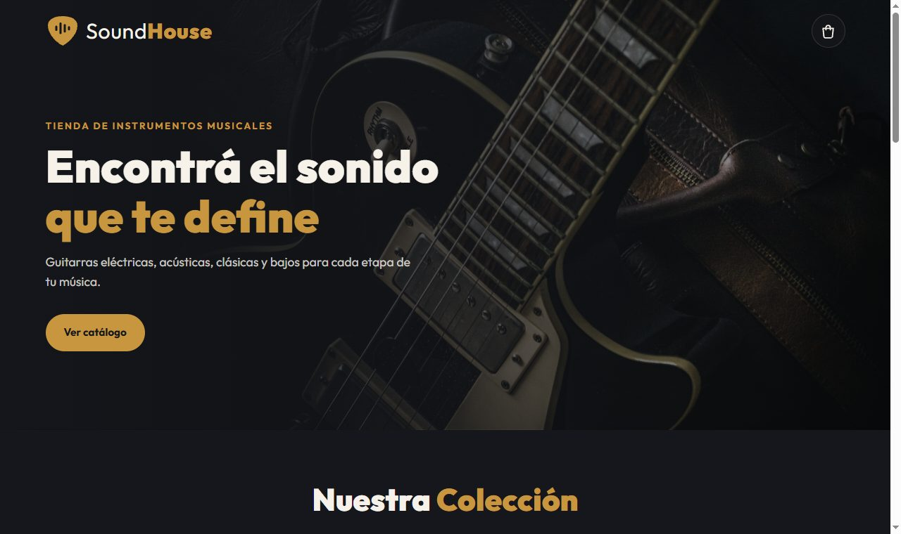
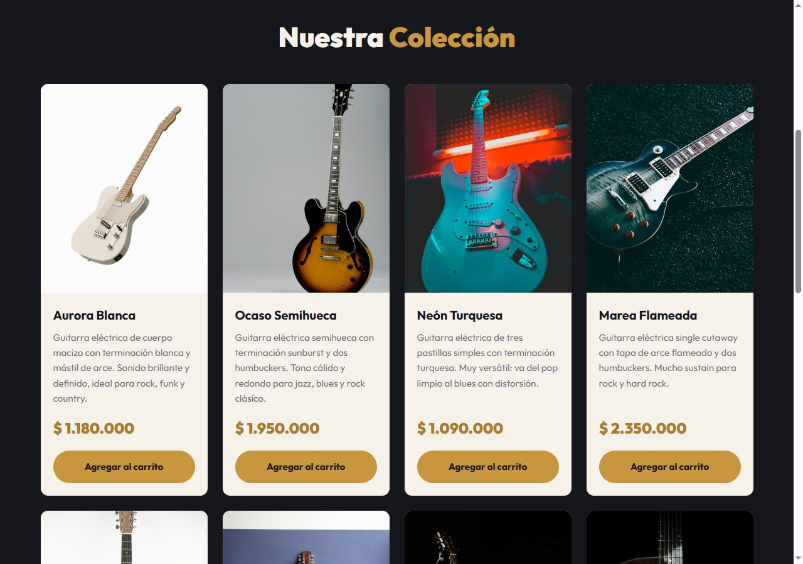
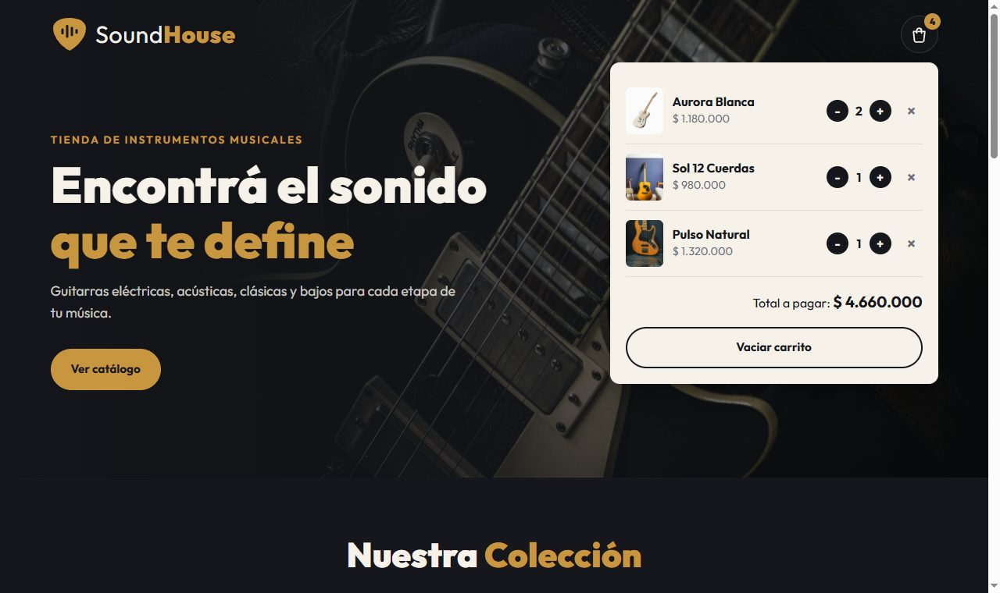
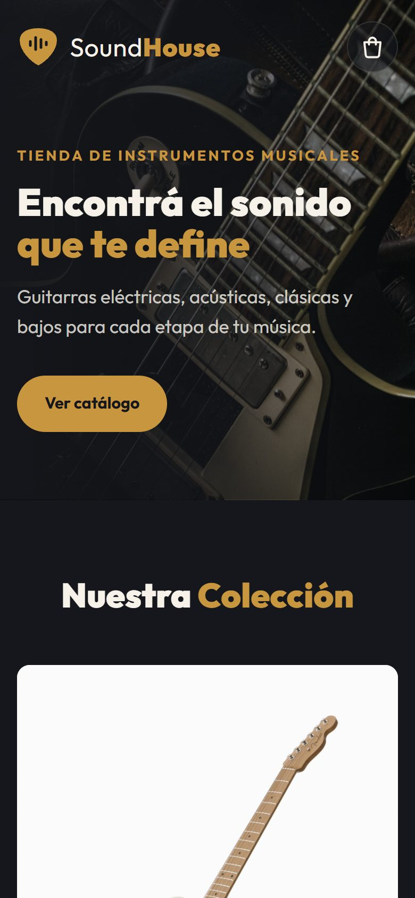
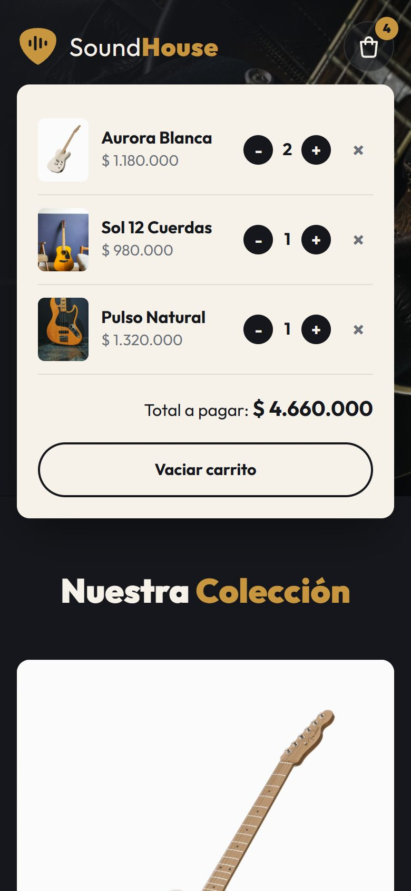

# SoundHouse 🎸

Tienda online de instrumentos musicales (guitarras eléctricas, acústicas, clásicas y bajos) desarrollada con **React** y **Vite**.

Muestra un catálogo de 12 productos y tiene un carrito de compras que se guarda en el navegador, así no se pierde al recargar la página. El diseño es propio, hecho con CSS sin frameworks, y se adapta a celulares, tablets y computadoras.

> Proyecto de portfolio. La tienda, los productos y los precios son ficticios.

<!-- Cuando el sitio esté publicado en Netlify, agregar aquí el link a la demo -->

## 📸 Capturas



| Catálogo | Carrito abierto |
|---|---|
|  |  |

| Celular | Carrito en celular |
|---|---|
|  |  |

## 🚀 Funcionalidades

- **Catálogo** de 12 instrumentos con foto, descripción y precio en pesos argentinos.
- **Carrito de compras:**
  - Agregar productos desde el catálogo.
  - Aumentar y disminuir cantidades (mínimo 1, máximo 5 unidades por producto).
  - Eliminar un producto o vaciar el carrito completo.
  - Total a pagar calculado automáticamente.
  - Contador de unidades sobre el ícono del carrito.
- **El carrito se abre y se cierra con clic o toque.** También se cierra al tocar fuera o con la tecla `Escape`.
- **Persistencia en LocalStorage:** el carrito se mantiene al recargar la página. Al cargarlo se actualizan los datos de cada producto (precio, nombre e imagen) desde el catálogo.
- **Diseño responsive** *mobile-first*: 1, 2, 3 o 4 columnas según el ancho de la pantalla.
- **Accesibilidad:** textos alternativos en las imágenes, `aria-label` y `aria-expanded` en los botones, navegación con teclado y respeto por la preferencia de reducir animaciones.

## 🛠️ Tecnologías

| Tecnología | Uso |
|---|---|
| **React 19** | Componentes funcionales y hooks |
| **Vite 6** | Entorno de desarrollo y build de producción |
| **JavaScript (ES Modules) y JSX** | Lógica de la aplicación |
| **CSS** | Estilos propios con variables, Flexbox, Grid y metodología BEM, sin frameworks |
| **ESLint** | Análisis estático del código |
| **Netlify** | Configuración de despliegue incluida en `netlify.toml` |

## 🧑‍💻 Conceptos aplicados

- **Custom Hook (`useCart`):** toda la lógica del carrito está en un hook, separada de los componentes que muestran la interfaz.
- **Estado inmutable:** el carrito se actualiza siempre creando arrays y objetos nuevos (`map`, `filter` y spread operator).
- **Actualizaciones con función (`setCart(prev => ...)`):** el estado nuevo se calcula a partir del más reciente, así no se pierden clics rápidos.
- **`useState` con inicialización perezosa:** el carrito se lee de LocalStorage solo al montar el componente.
- **`useEffect`:** sincroniza el carrito con LocalStorage y maneja los eventos para cerrar el carrito, con su función de limpieza.
- **`useRef`:** detecta si un clic o toque ocurrió fuera del carrito y devuelve el foco al botón.
- **`useMemo`:** calcula los valores derivados (carrito vacío, total y cantidad de unidades) solo cuando cambia el carrito.
- **`Intl.NumberFormat`:** muestra los precios en pesos argentinos (`$ 1.180.000`).
- **Componentes reutilizables y props:** `Header` y `Guitar` reciben desde `App` los datos y las funciones que necesitan.

## 📁 Estructura del proyecto

```
├── docs/screenshots/     # Capturas usadas en este README
├── public/img/           # Fotos de productos, logo e íconos
├── src/
│   ├── components/
│   │   ├── Guitar.jsx    # Tarjeta de cada producto del catálogo
│   │   └── Header.jsx    # Logo, carrito y portada
│   ├── data/
│   │   └── db.js         # Datos de los productos
│   ├── helpers/
│   │   └── index.js      # Formato de precios
│   ├── hooks/
│   │   └── useCart.js    # Lógica del carrito (custom hook)
│   ├── App.jsx
│   ├── index.css         # Estilos de toda la aplicación
│   └── main.jsx
├── CREDITS.md            # Créditos y licencias de las imágenes
└── netlify.toml          # Configuración de despliegue
```

## ▶️ Cómo ejecutarlo

Necesitás tener instalado [Node.js](https://nodejs.org/) 20 o superior.

```bash
# Clonar el repositorio
git clone https://github.com/luchinileo/guitarra-2025-js.git
cd guitarra-2025-js

# Instalar dependencias
npm install

# Levantar el servidor de desarrollo
npm run dev
```

Otros comandos:

```bash
npm run build     # Genera la versión de producción en /dist
npm run preview   # Sirve localmente el build de producción
npm run lint      # Revisa el código con ESLint
```

## 🌐 Despliegue

El proyecto está listo para publicarse en **Netlify** desde GitHub. El archivo [`netlify.toml`](netlify.toml) define:

- Comando de build: `npm run build`
- Carpeta de publicación: `dist`
- Versión de Node.js: 22
- Redirección de todas las rutas a `index.html`, para que recargar la página nunca devuelva un error 404

## 📷 Créditos

Las fotografías de instrumentos son de [Unsplash](https://unsplash.com) y se usan bajo la [Licencia Unsplash](https://unsplash.com/license). El detalle de cada foto y su autor está en [CREDITS.md](CREDITS.md).

El logo y los íconos son diseños propios. La tipografía es [Outfit](https://fonts.google.com/specimen/Outfit), de Google Fonts.

---

Desarrollado por [luchinileo](https://github.com/luchinileo) como proyecto de portfolio Frontend.
